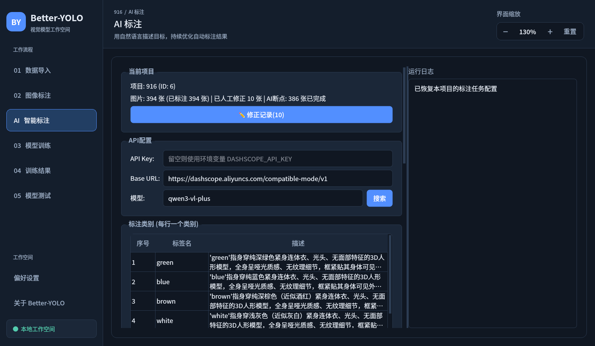

# Better-YOLO 全流程YOLO训练工具

[](#版本更新日志)
[](CHANGELOG.md)


基于 PyQt6 的纯本地桌面应用，覆盖 **数据导入 → 图像标注 → YOLO训练 → 结果分析 → 模型测试** 的完整工作流。

集成了以 **Qwen-VL 多模态大模型为核心的 AI 自动标注闭环**，支持通过"AI 生成提示词 → 试标 → 人工修正 → AI 对比反馈再优化"的方式持续提升 AI 标注准确率。

> 📖 **新手请看 [docs/TUTORIAL.md](docs/TUTORIAL.md) 图文教学**：从创建项目到训练出模型的完整流程演示（含全部界面截图）。



## 功能特性

- **项目式管理**：导入、标注、训练、测试全部在项目内进行，图片复制进 `projects/<项目名>_<时间戳>/`
- **数据导入与整理**：图片文件夹批量导入、视频抽帧、已有 YOLO/COCO/VOC 标注导入，支持**一键重命名数据集图片与对应标签**（默认 `img_001` 起，支持自定义起始编号与外部目录配对改名）
- **手动标注**：矩形 / 多边形 / 关键点标注，支持撤销重做、类别管理、批量操作、标注导出与**按比例划分导出完整数据集**（支持 `images/{train,val}` 默认结构与 `train/{images,labels}` 服务器结构，默认 `8:2`）
- **YOLO 自动标注**：加载 YOLO 系列多代模型单张/批量推理自动画框
- **SAM 辅助标注**：SAM / SAM2(含2.1) / MobileSAM / FastSAM 等交互式分割，点/框提示生成 mask
- **✦ AI 标注（大模型）**：Qwen-VL 系列多模态大模型按提示词检测画框，无需预训练模型
- **训练**：YOLO 多代全系列模型，训练参数可视化配置、实时进度与指标监控
- **结果分析**：损失曲线 / mAP / 混淆矩阵 / 预测可视化 / 权重导出(PT / ONNX等)
- **模型测试**：加载图片/视频一键推理并可视化

## AI 标注闭环（本项目核心特色）

"✦ AI 标注"页面通过自然语言类别描述驱动检测，内置一整套**发现错误 → 修正 → 让 AI 越标越准**的机制：

1. **类别表**：标签名 + 视觉特征描述（AI 逐字沿用既有标签名，含纯数字编号），另有附加规则与"负样本排除"
2. **AI 生成提示词**：参考"采样图片 + 用户手画示例/反馈参考图"后，由大模型自动生成/改写类别描述
3. **多轮检测取平均**：同一张图多次检测，IoU 聚类合并，抑制框抖动；可选**二次放大精修**提升贴边精度
4. **断点续标 + 试标**：中断自动续跑；可先只标 N 张验证效果再全量
5. **四态复核与锁定保护**：区分 `○` 未标注、`✓` 待复核（AI 初标）、`✓ 🔒` 已确认锁定（纯人工首标或按 `L` 确认无误的 AI 预测）与 `✓ ✏️🔒` 已复标修正；锁定的图片在 AI/YOLO 重标时整图跳过，绝不覆盖人工成果
6. **对比反馈再优化**：对经过 AI 标注的图片进行增/删/改框或改类别后，自动生成"AI 原始结果(红框) vs 修正后(绿框)"对比图喂给 AI，AI 分析自身错误模式（误框背景、类别认错、框太松/漏检等），**自动重写类别描述并更新负样本排除**，且自动重置旧断点以便一键重标其余未锁定图片
7. **修改可视化**：图片列表 `✏️🔒` / `🔒` 徽标、复核状态筛选器（待复核 / 已锁定 / 已复标修正）、项目统计与"✏️ 修正记录"红绿框对比查看器

## 版本更新日志

> 完整历史变更记录请查看 **[CHANGELOG.md](CHANGELOG.md)**。

| 版本 | 日期 | 类型 | 核心更新内容 |
| :--- | :--- | :--- | :--- |
| **`v1.3.1`** | `2026-11-25` | ⚡ 优化 | 导出格式、目录结构与训练:验证比例改为**点击导出按钮后独立弹窗配置**（含目录树预览），精简标注页右侧栏并释放「类别列表」完整显示空间 |
| **`v1.3.0`** | `2026-11-25` | 🚀 特性 | 导出完整数据集新增**默认结构**（`images/{train,val}` + `labels/{train,val}`）与**服务器结构**（`train/{images,labels}` + `val/{images,labels}`）选择及训练:验证比例划分（默认 `8:2`） |
| **`v1.2.0`** | `2026-11-25` | 🚀 特性 | 新增**一键重命名数据集图片与标签**功能（默认 `img_001` 起，可自由指定起始编号与前缀，同时支持当前项目与外部 YOLO/VOC/COCO 数据集目录双阶段无冲突重命名） |
| **`v1.1.2`** | `2026-11-25` | ✨ 新增 | `✦ AI标注` 页面右侧运行日志栏顶部新增 **「清除日志」** 一键清空按钮 |
| **`v1.1.1`** | `2026-11-25` | 🔧 修复 | 修复多轮迭代学习后重标显示 `待处理数量: 0` 的问题：引入任务配置指纹 `task_signature`，提示词/负样本更新或开启覆盖时自动重置旧断点重标未锁定图片 |
| **`v1.1.0`** | `2026-11-25` | 🚀 特性 | 重构整图锁定（`🔒`）与人工复标（`✏️`）四态判定机制（基于 `ai_original` 快照比对）；新增整图锁定快捷键 `L` 与 `待复核 / 已锁定 / 已复标修正` 筛选；补齐单击防误触、`Ctrl+Z` 撤销回退及解锁移出断点闭环 |
| **`v1.0.4`** | `2026-11-24` | 🔧 修复 | 修复大模型用分号 `；` 单行连写多类别提示词时仅更新首个标签的问题，支持括号层级感知拆分与尾部规则提取 |
| **`v1.0.3`** | `2026-11-24` | ✨ 新增 | `02 图像标注` 画布新增目标框左上角**类别名胶囊标签**实时渲染（纯 UI 显示，不污染导出的 YOLO `.txt`） |
| **`v1.0.2`** | `2026-11-24` | ⚡ 优化 | 移除标注页默认预设的 `person/car` 类别；打通 `02 图像标注` ⇄ `✦ AI标注` 双向类别名称自动同步（保留描述交由 AI 生成） |
| **`v1.0.1`** | `2026-11-24` | ⚡ 优化 | 图像/视频导入启用 MD5 去重与后台异步线程；COCO/VOC/YOLO 标注导入提速并支持补导原图；补齐分割多边形 YOLO 导出与 COCO 完整数据集导出 |
| **`v1.0.0`** | `2026-10-25` | 🎉 发布 | 初始版本发布：覆盖项目式导入、手动/YOLO/SAM/Qwen-VL 闭环标注、多代 YOLO 训练、结果分析导出与推理测试 |

<details>
<summary><b>展开查看近期版本详细说明（v1.1.0 – v1.1.2）</b></summary>

#### `[1.1.2]` - 2026-11-25
- 在 `✦ AI 智能标注` 页面右侧「运行日志」标题栏新增「清除日志」按钮，方便多轮试标与迭代调试时清空历史输出。

#### `[1.1.1]` - 2026-11-25
- 为 `ai_progress.json` 断点记录引入任务配置指纹（`task_signature`，涵盖提示词、负样本排除与示例图），当配置变更、「AI生成提示词」完成回填或勾选「覆盖图片已有标注」时自动重置旧断点，跳过已锁定图片并重新标定全部未锁定图片。
- 补齐 AI 重标过滤误检后输出 `0` 个框时的 `annotated` 状态同步。

#### `[1.1.0]` - 2026-11-25
- 明确区分纯人工首标（`✓ 🔒`）与 AI 复标纠错（`✓ ✏️🔒`），消除纯手标无 AI 快照图片误入「✏️ 修正记录」的问题。
- 修复选中/取消选中单框时覆盖并禁用「🔒 锁定本图」按钮的问题；新增整图锁定快捷键 `L`（可在偏好设置修改）及 `待复核` / `已锁定` / `已复标修正` 列表筛选器。
- 修复移动模式下仅单击未拖动即误触发修改锁定的问题；补齐修改类别、标记负样本、删除类别、`Ctrl+Z` 撤销回退与解锁移出 AI 断点的完整闭环。

</details>

## 安装

```bash
# 1. 安装依赖
pip install -r requirements.txt

# 2. 运行
python main.py
```

注意事项：

1. **GPU 训练**：请自行安装 CUDA 版 PyTorch（参考 https://pytorch.org/get-started/locally/ 选择适配本机环境的版本）
2. **YOLOv26**：需将 ultralytics 升级到最新：`pip install -U ultralytics`
3. **✦ AI 标注**：需要可访问 OpenAI 兼容接口的大模型 API Key。在 AI 标注页的 API 配置中直接填写（Dashscope 默认地址），配置保存在 `config/llm_config.json`（已被 .gitignore 排除，勿提交）；也可使用环境变量 `DASHSCOPE_API_KEY`
4. 推荐使用 conda 等虚拟环境安装

## 界面与使用

左侧导航（按流程顺序，逐页详细操作见 [docs/TUTORIAL.md](docs/TUTORIAL.md)）：

| 页面 | 作用 |
| --- | --- |
| ① 导入 | 创建/打开项目，导入图片、视频、已有标注 |
| ② 标注 | 手动标注 / YOLO自动标注 / SAM辅助标注 / 批处理 / 导出 |
| ✦ AI标注 | Qwen-VL 大模型标注：类别表、负样本、提示词生成、批量标注 |
| ③ 训练 | YOLO 模型训练参数配置与训练 |
| ④ 训练结果 | 训练指标、图表、权重导出 |
| ⑤ 测试 | 用训练好的模型推理图片/视频 |
| ⚙ 设置 / ⓘ 关于 | 应用配置与信息 |

### 界面缩放

- 右上角「界面缩放」可用 `−` / `+` 调整，也可直接输入 **75%–200%**；点击「重置」恢复 100%。
- 快捷键：`Ctrl++` / `Ctrl+=` 放大，`Ctrl+-` 缩小，`Ctrl+0` 恢复 100%。
- 「偏好设置 → 界面与显示 → 整体缩放」提供常用比例，与顶部控件同步，并自动记住上次使用的比例。
- 字体、按钮、输入框、面板间距、缩略图和应用内对话框同步调整。放大后页面可滚动，标注工具栏自动换行；图像标注坐标不受界面缩放影响。

### 手动标注

1. 标注页左侧选图 → 右侧选标注工具（矩形/多边形/关键点）与类别 → 画布绘制，标注自动保存
2. 手动画框或确认无误的图按 `L` 锁定为 **✓ 🔒**；修改过 AI 标注结果的图自动标记为 **✓ ✏️🔒**
3. 快捷键：`Q` 矩形、`P` 多边形、`E` 移动、`A`/`D` 上一张/下一张、`L` 锁定/解锁本图、`Delete` 删除选中、`Ctrl+Z` 撤销、`R` 重置视图、`1-9` 切换类别、`Esc` 退出交互模式

### 大模型自动标注（✦ AI标注页）

1. 打开一个项目后进入该页
2. **类别表**：逐行填"标签名"(classes.txt 用名，可为纯数字编号) + "描述"(视觉特征、贴边要求、易混淆物区别)；可"导入 classes.txt" 只填名称，再用"AI生成提示词"让 AI 补全描述
3. 配置 **API Key / Base URL / 模型**，设置检测轮数、是否二次放大精修、试标数量(0=全部)
4. 点击"开始标注"，结果写入数据库，切到"标注"页查看与修正

#### 迭代优化（越标越准）

- 手动画好几张示例图后点击 **"从手动标注生成"**，再 **"AI生成提示词"**，AI 根据标准答案生成类别描述回填表格
- AI 大规模标错后：在标注页修正若干张（拖动框、删掉误框的背景/障碍物、补画漏检目标），再点"AI生成提示词"。勾选对话框中的 ✏️ 修正图，AI 会收到"红框=AI原结果 vs 绿框=人工修正"对比图，据此改写描述与负样本排除并自动覆盖填入

### YOLO / SAM 自动标注

1. 标注页点 **🤖 自动标注** → 设置中选模型与参数
2. **YOLO**：单张推理或批量推理，结果可直接调整
3. **SAM**：进入 SAM 交互，左键点目标 / Ctrl+多点 / 右键框选，模型生成 mask 转标注

### 训练 / 结果 / 测试

- 训练页选择模型版本型号、划分数据集并配置超参后开始训练，进度与曲线实时显示；输出在 `runs/`
- 训练结果页查看指标、混淆矩阵并导出权重（PT / ONNX 等）
- 测试页加载权重（自动优先本项目 best.pt）与图片/视频，调整置信度/IOU 后推理

## 数据与目录

| 路径 | 说明 |
| --- | --- |
| `data/BetterYOLO.db` | SQLite 元数据库：图片记录、标注、类别、训练任务 |
| `projects/` | 项目文件夹：导入的图片副本、AI 任务配置/断点/示例图 |
| `pretrained/` | YOLO/SAM 模型自动下载目录 |
| `datasets/` | 训练用数据集导出目录 |
| `runs/` | ultralytics 训练输出 |
| `config/*.json` | AI 标注 API Key / SAM 配置（**勿提交**） |

> 提示：删除项目请在软件内操作；手动删除或挪走项目文件夹会与数据库不同步。项目文件夹内请勿放置非 `ai_` 开头的散文件，启动同步会清理不在数据库中的孤立图片。

## 项目结构

```
Better-yolo/
├── main.py                  # 入口
├── docs/                    # 图文教学(TUTORIAL.md)与截图
├── models/database.py       # SQLite 数据库层
├── core/                    # 业务逻辑
│   ├── qwen_annotator.py    # AI标注核心: 检测/提示词生成/修正对比反馈
│   ├── auto_labeler.py      # YOLO 自动标注
│   ├── annotation_importer.py
│   └── model_manager.py     # 模型自动下载
├── gui/
│   ├── main_window.py       # 主窗口与导航
│   └── pages/               # 各功能页(导入/标注/AI标注/训练/结果/测试/设置/关于)
└── config/                  # 本地运行配置(API Key 等, 不入库)
```

## 常见问题

- **模型下载失败**：检查网络；ultralytics 会下载到 `pretrained/`，可手动放入
- **训练内存不足**：减小 batch size / image size，或改用更小型号(如 `n`)
- **AI 标注误框背景/障碍物**：在标注页把误框删掉（图片被修正锁定），再到 AI 标注页点"AI生成提示词"，AI 会自动把该物体写入负样本排除
- **AI 类别描述不更新**：若对话框锁定图未勾选或该图无 AI 快照，会退化为普通"标准答案"反馈；修正过的图（✏️）才会附带红绿对比图
- **视频导入较慢**：后台处理不阻塞界面，留意进度条
