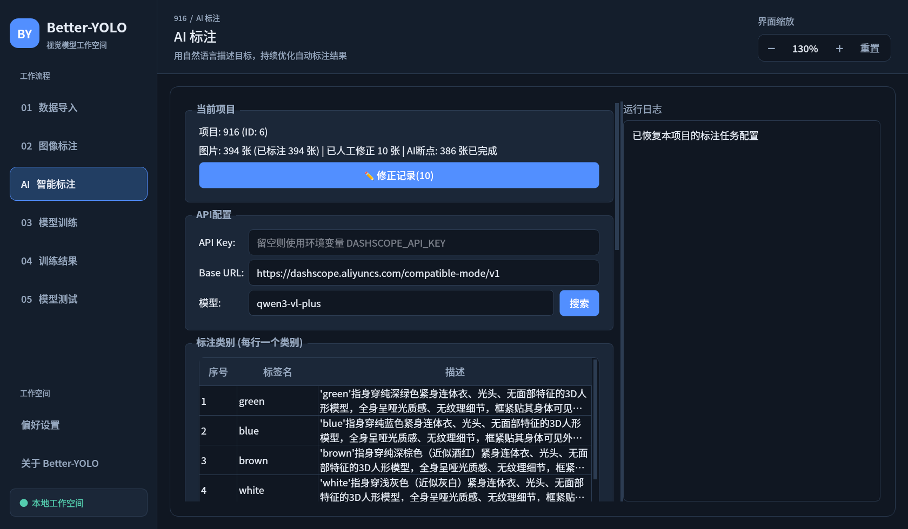

# Better-YOLO 全流程YOLO训练工具


基于 PyQt6 的纯本地桌面应用，覆盖 **数据导入 → 图像标注 → YOLO训练 → 结果分析 → 模型测试** 的完整工作流。

集成了以 **Qwen-VL 多模态大模型为核心的 AI 自动标注闭环**，支持通过"AI 生成提示词 → 试标 → 人工修正 → AI 对比反馈再优化"的方式持续提升 AI 标注准确率。

> 📖 **新手请看 [docs/TUTORIAL.md](docs/TUTORIAL.md) 图文教学**：从创建项目到训练出模型的完整流程演示（含全部界面截图）。



## 功能特性

- **项目式管理**：导入、标注、训练、测试全部在项目内进行，图片复制进 `projects/<项目名>_<时间戳>/`
- **数据导入**：图片文件夹批量导入、视频抽帧、已有 YOLO 标注(txt)导入
- **手动标注**：矩形 / 多边形 / 关键点标注，支持撤销重做、类别管理、批量操作、标注导出（YOLO格式）与完整数据集导出
- **YOLO 自动标注**：加载 YOLO 系列多代模型单张/批量推理自动画框
- **SAM 辅助标注**：SAM / SAM2(含2.1) / MobileSAM / FastSAM 等交互式分割，点/框提示生成 mask
- **✦ AI 标注（大模型）**：Qwen-VL 系列多模态大模型按提示词检测画框，无需预训练模型
- **训练**：YOLO 多代全系列模型，训练参数可视化配置、实时进度与指标监控
- **结果分析**：损失曲线 / mAP / 混淆矩阵 / 预测可视化 / 权重导出(PT / ONNX等)
- **模型测试**：加载图片/视频一键推理并可视化

## AI 标注闭环（本项目核心特色）

"✦ AI 标注"页面通过自然语言类别描述驱动检测，内置一整套**发现错误 → 修正 → 让 AI 越标越准**的机制：

1. **类别表**：标签名 + 视觉特征描述（AI 逐字沿用既有标签名，含纯数字编号），另有附加规则与"负样本排除"
2. **AI 生成提示词**：参考"采样图片 + 用户手画示例/反馈参考图"后，由大模型自动生成/改写类别描述
3. **多轮检测取平均**：同一张图多次检测，IoU 聚类合并，抑制框抖动；可选**二次放大精修**提升贴边精度
4. **断点续标 + 试标**：中断自动续跑；可先只标 N 张验证效果再全量
5. **人工修正即锁定**：在标注页增/删/改任何框，该图自动整图锁定（🔒），AI 重标时跳过，已修正框不再被 AI 覆盖
6. **对比反馈再优化**：锁定图经用户修正后，生成"AI 原始结果(红框) vs 修正后(绿框)"对比图喂给 AI，AI 分析自身错误模式（多框背景/障碍物、类别认错、框太松/漏检等），**自动重写类别描述并更新负样本排除**
7. **修改可视化**：图片列表 ✏️ 徽标、项目统计"已人工修正 N 张"、"✏️ 修正记录"查看器内左右对比预览红/绿框

## 安装

```bash
# 1. 安装依赖
pip install -r requirements.txt

# 2. 运行
python main.py
```

注意事项：

1. **GPU 训练**：请自行安装 CUDA 版 PyTorch（参考 https://pytorch.org/get-started/locally/ 选择适配本机环境的版本）
2. **YOLOv26**：需将 ultralytics 升级到最新：`pip install -U ultralytics`
3. **✦ AI 标注**：需要可访问 OpenAI 兼容接口的大模型 API Key。在 AI 标注页的 API 配置中直接填写（Dashscope 默认地址），配置保存在 `config/llm_config.json`（已被 .gitignore 排除，勿提交）；也可使用环境变量 `DASHSCOPE_API_KEY`
4. 推荐使用 conda 等虚拟环境安装

## 界面与使用

左侧导航（按流程顺序，逐页详细操作见 [docs/TUTORIAL.md](docs/TUTORIAL.md)）：

| 页面 | 作用 |
| --- | --- |
| ① 导入 | 创建/打开项目，导入图片、视频、已有标注 |
| ② 标注 | 手动标注 / YOLO自动标注 / SAM辅助标注 / 批处理 / 导出 |
| ✦ AI标注 | Qwen-VL 大模型标注：类别表、负样本、提示词生成、批量标注 |
| ③ 训练 | YOLO 模型训练参数配置与训练 |
| ④ 训练结果 | 训练指标、图表、权重导出 |
| ⑤ 测试 | 用训练好的模型推理图片/视频 |
| ⚙ 设置 / ⓘ 关于 | 应用配置与信息 |

### 界面缩放

- 右上角「界面缩放」可用 `−` / `+` 调整，也可直接输入 **75%–200%**；点击「重置」恢复 100%。
- 快捷键：`Ctrl++` / `Ctrl+=` 放大，`Ctrl+-` 缩小，`Ctrl+0` 恢复 100%。
- 「偏好设置 → 界面与显示 → 整体缩放」提供常用比例，与顶部控件同步，并自动记住上次使用的比例。
- 字体、按钮、输入框、面板间距、缩略图和应用内对话框同步调整。放大后页面可滚动，标注工具栏自动换行；图像标注坐标不受界面缩放影响。

### 手动标注

1. 标注页左侧选图 → 右侧选标注工具（矩形/多边形/关键点）与类别 → 画布绘制，标注自动保存
2. 拖动/调整已有框即视为"人工修正"，该图自动锁定，列表中带 **✏️🔒** 徽标
3. 快捷键：`W` 矩形、`P` 多边形、`V` 移动、`Delete` 删除选中、`Ctrl+Z` 撤销、`R` 重置视图、`1-9` 切换类别、`Esc` 退出交互模式

### 大模型自动标注（✦ AI标注页）

1. 打开一个项目后进入该页
2. **类别表**：逐行填"标签名"(classes.txt 用名，可为纯数字编号) + "描述"(视觉特征、贴边要求、易混淆物区别)；可"导入 classes.txt" 只填名称，再用"AI生成提示词"让 AI 补全描述
3. 配置 **API Key / Base URL / 模型**，设置检测轮数、是否二次放大精修、试标数量(0=全部)
4. 点击"开始标注"，结果写入数据库，切到"标注"页查看与修正

#### 迭代优化（越标越准）

- 手动画好几张示例图后点击 **"从手动标注生成"**，再 **"AI生成提示词"**，AI 根据标准答案生成类别描述回填表格
- AI 大规模标错后：在标注页修正若干张（拖动框、删掉误框的背景/障碍物、补画漏检目标），再点"AI生成提示词"。勾选对话框中的 ✏️ 修正图，AI 会收到"红框=AI原结果 vs 绿框=人工修正"对比图，据此改写描述与负样本排除并自动覆盖填入

### YOLO / SAM 自动标注

1. 标注页点 **🤖 自动标注** → 设置中选模型与参数
2. **YOLO**：单张推理或批量推理，结果可直接调整
3. **SAM**：进入 SAM 交互，左键点目标 / Ctrl+多点 / 右键框选，模型生成 mask 转标注

### 训练 / 结果 / 测试

- 训练页选择模型版本型号、划分数据集并配置超参后开始训练，进度与曲线实时显示；输出在 `runs/`
- 训练结果页查看指标、混淆矩阵并导出权重（PT / ONNX 等）
- 测试页加载权重（自动优先本项目 best.pt）与图片/视频，调整置信度/IOU 后推理

## 数据与目录

| 路径 | 说明 |
| --- | --- |
| `data/BetterYOLO.db` | SQLite 元数据库：图片记录、标注、类别、训练任务 |
| `projects/` | 项目文件夹：导入的图片副本、AI 任务配置/断点/示例图 |
| `pretrained/` | YOLO/SAM 模型自动下载目录 |
| `datasets/` | 训练用数据集导出目录 |
| `runs/` | ultralytics 训练输出 |
| `config/*.json` | AI 标注 API Key / SAM 配置（**勿提交**） |

> 提示：删除项目请在软件内操作；手动删除或挪走项目文件夹会与数据库不同步。项目文件夹内请勿放置非 `ai_` 开头的散文件，启动同步会清理不在数据库中的孤立图片。

## 项目结构

```
Better-yolo/
├── main.py                  # 入口
├── docs/                    # 图文教学(TUTORIAL.md)与截图
├── models/database.py       # SQLite 数据库层
├── core/                    # 业务逻辑
│   ├── qwen_annotator.py    # AI标注核心: 检测/提示词生成/修正对比反馈
│   ├── auto_labeler.py      # YOLO 自动标注
│   ├── annotation_importer.py
│   └── model_manager.py     # 模型自动下载
├── gui/
│   ├── main_window.py       # 主窗口与导航
│   └── pages/               # 各功能页(导入/标注/AI标注/训练/结果/测试/设置/关于)
└── config/                  # 本地运行配置(API Key 等, 不入库)
```

## 常见问题

- **模型下载失败**：检查网络；ultralytics 会下载到 `pretrained/`，可手动放入
- **训练内存不足**：减小 batch size / image size，或改用更小型号(如 `n`)
- **AI 标注误框背景/障碍物**：在标注页把误框删掉（图片被修正锁定），再到 AI 标注页点"AI生成提示词"，AI 会自动把该物体写入负样本排除
- **AI 类别描述不更新**：若对话框锁定图未勾选或该图无 AI 快照，会退化为普通"标准答案"反馈；修正过的图（✏️）才会附带红绿对比图
- **视频导入较慢**：后台处理不阻塞界面，留意进度条
