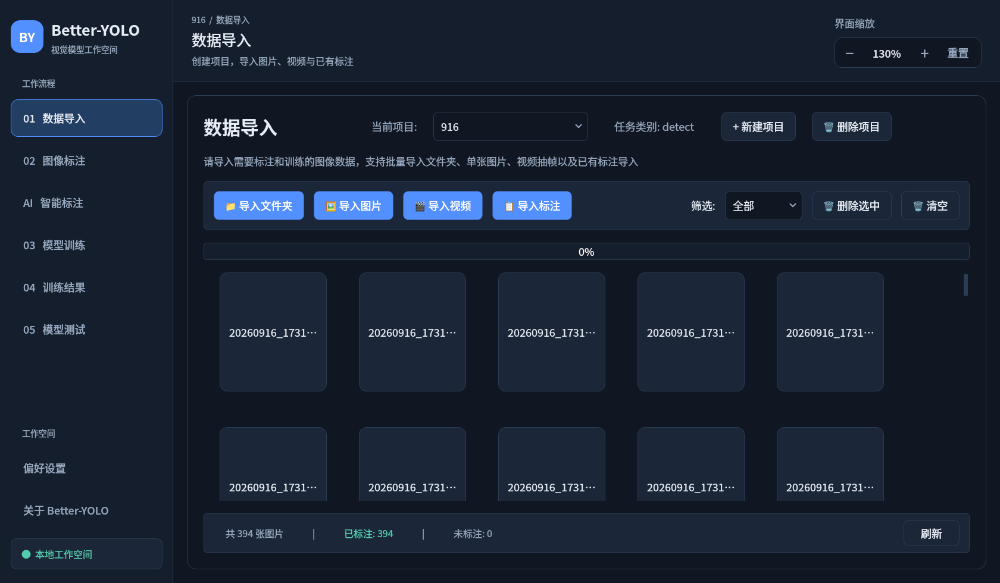
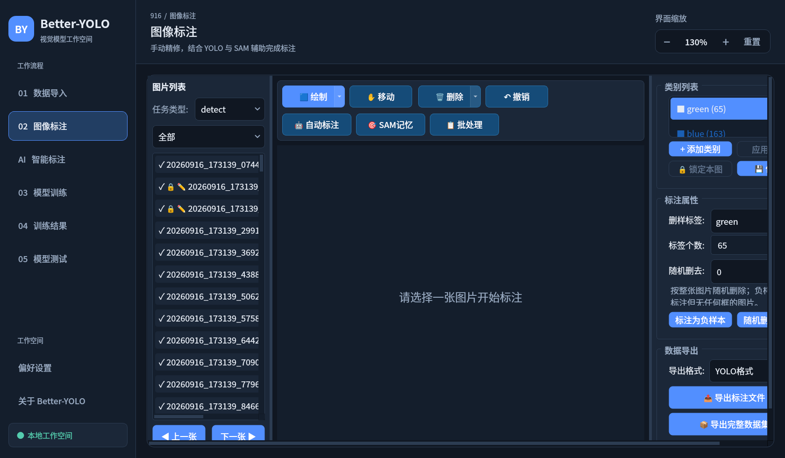
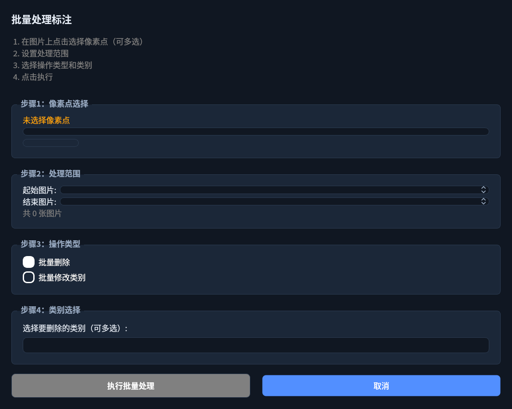
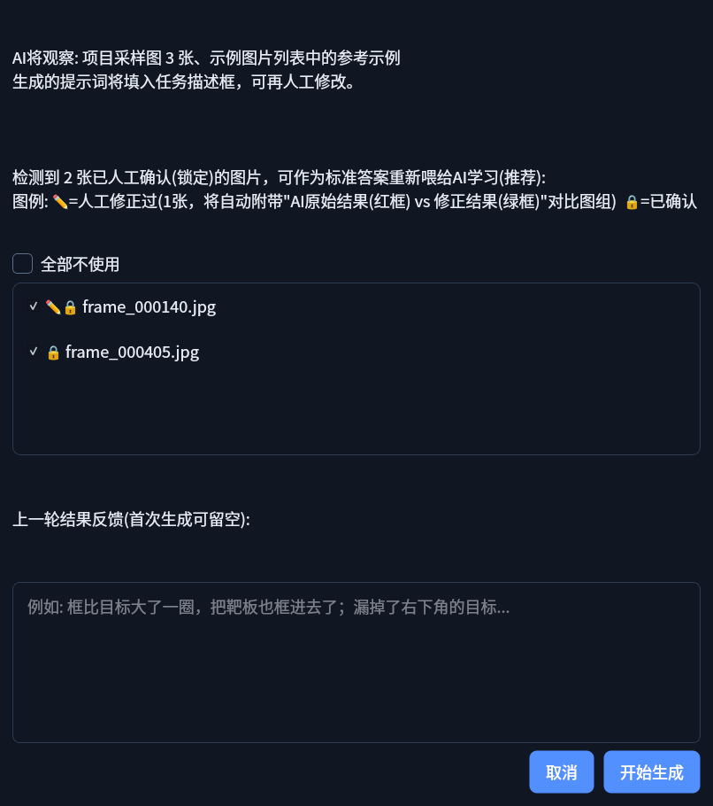
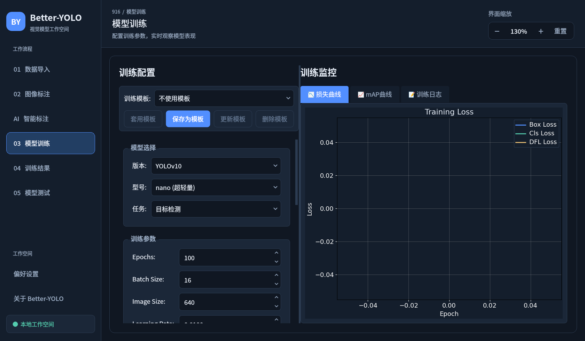
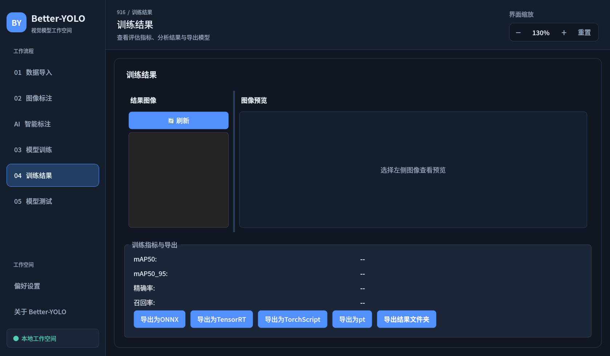
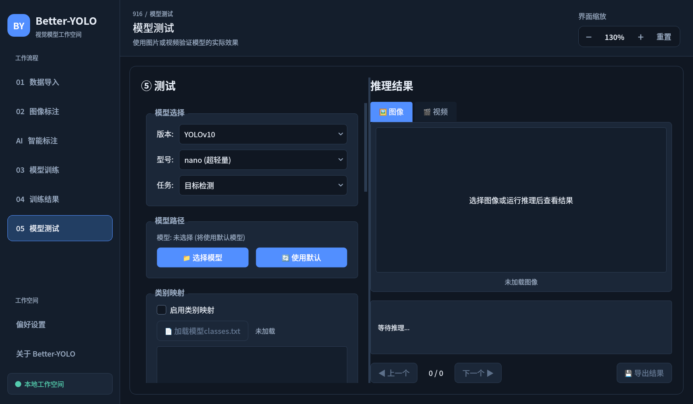
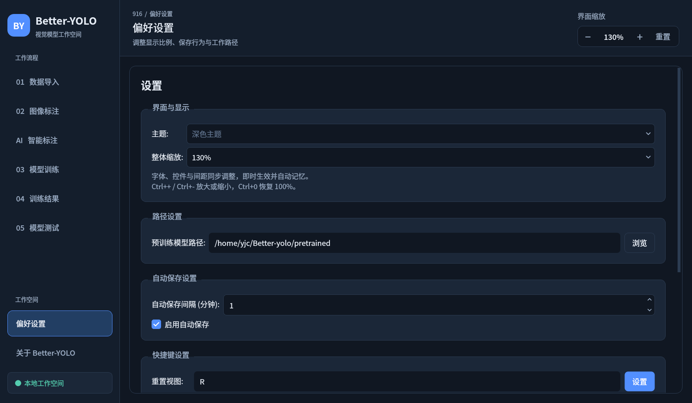

# Better-YOLO 图文教学：从零到训练出你自己的 YOLO 模型

> 本教程带你走完 **创建项目 → 导入数据 → 标注（手动 / AI / SAM）→ 训练 → 分析 → 测试** 的完整流程。
> 全部截图来自软件实际界面（v1.0.0）。

---

## 目录

1. [安装与启动](#1-安装与启动)
2. [界面总览](#2-界面总览)
3. [第一步：创建项目与导入数据](#3-第一步创建项目与导入数据)
4. [第二步：图像标注](#4-第二步图像标注)
5. [第三步：AI 智能标注（核心特色）](#5-第三步ai-智能标注核心特色)
6. [第四步：模型训练](#6-第四步模型训练)
7. [第五步：训练结果分析](#7-第五步训练结果分析)
8. [第六步：模型测试](#8-第六步模型测试)
9. [偏好设置](#9-偏好设置)
10. [数据存放与备份](#10-数据存放与备份)
11. [常见问题](#11-常见问题)

---

## 1. 安装与启动

```bash
# 1) 建议先创建虚拟环境 (conda / venv 均可)
conda create -n better-yolo python=3.10 -y
conda activate better-yolo

# 2) 安装依赖
pip install -r requirements.txt

# 3) 启动
python main.py
```

> GPU 训练请另装 CUDA 版 PyTorch，参考 https://pytorch.org/get-started/locally/

---

## 2. 界面总览

启动后进入主窗口。**左侧是工作流程导航**，按从上到下的顺序使用即可：



| 导航 | 作用 |
| --- | --- |
| 01 数据导入 | 创建项目，导入图片 / 视频 / 已有标注 |
| 02 图像标注 | 手动画框，配合 YOLO 与 SAM 辅助 |
| AI 智能标注 | 用自然语言描述目标，让大模型批量画框 |
| 03 模型训练 | 配置超参数并启动训练 |
| 04 训练结果 | 指标曲线、混淆矩阵、权重导出 |
| 05 模型测试 | 用训练好的模型推理图片 / 视频 |
| 偏好设置 | 缩放、路径、自动保存、快捷键 |

右上角「**界面缩放**」可调整全局显示比例（75%–200%），快捷键 `Ctrl++` / `Ctrl+-` / `Ctrl+0`。

**所有操作都在"项目"内进行**：导入的图片会复制到 `projects/<项目名>_<时间戳>/`，标注、训练、测试都挂在同一项目下，互不干扰。

---

## 3. 第一步：创建项目与导入数据

1. 顶部下拉框旁点击「**+ 新建项目**」，填写项目名称与描述
2. 在顶部下拉框选中刚创建的项目
3. 使用工具栏按钮导入数据：

| 按钮 | 用途 |
| --- | --- |
| 📁 导入文件夹 | 整个文件夹的图片一次性导入 |
| 🖼 导入图片 | 选择若干图片导入 |
| 🎬 导入视频 | 自动抽帧成图片（后台处理，不卡界面） |
| 📋 导入标注 | 导入已有 YOLO 格式 txt 标注 |
| 🗑 删除选中 / 清空 | 移除图片（项目内副本与数据库记录一并清理） |

导入后左侧出现图片列表，底部状态栏显示统计（图片数 / 已标注数）。点击「刷新」可重新统计。

> 提示：图片导入时是**复制**进项目文件夹的，原始图片不受影响；删除项目请在软件内操作，手动删除文件夹会与数据库不同步。

---

## 4. 第二步：图像标注

选中项目后切换到「02 图像标注」：



页面分为三块：**左侧图片列表**、**中间画布与工具栏**、**右侧类别与属性面板**。

### 4.1 手动标注

1. 左侧点选一张图片
2. 在工具栏选择工具，或直接用快捷键：

| 快捷键 | 功能 |
| --- | --- |
| `W` | 矩形框 |
| `P` | 多边形 |
| `V` | 移动 / 调整 |
| `Delete` | 删除选中标注 |
| `Ctrl+Z` | 撤销 |
| `R` | 重置视图 |
| `1-9` | 快速切换类别 |
| `Esc` | 退出交互模式 |

3. 在画布上拖拽绘制，标注**自动保存**
4. 右侧「类别列表」可新增/删除类别（带颜色区分）；「标注属性」显示当前图的标签数

### 4.2 YOLO / SAM 自动标注

工具栏「**🤖 自动标注**」打开对话框：

- **YOLO 模式**：加载本地或自动下载的 YOLO 模型，对单张 / 批量图片推理画框，结果可直接手动调整
- **SAM 模式**：进入交互式分割 —— 左键点目标、`Ctrl+` 多点、右键框选，模型生成掩码后转为标注（支持 SAM / SAM2 / MobileSAM / FastSAM）

「**📋 批处理**」打开批量处理对话框，可对整个项目的图片批量执行自动标注：



### 4.3 图片列表徽标含义

- ✓ —— 已有标注
- 🔒 —— 已人工确认（锁定），AI 重标时自动跳过
- ✏️ —— 人工修正过（AI 标注后手动调整过框）

### 4.4 导出

右侧「数据导出」面板：

- **导出标注文件**：YOLO txt 格式
- **导出完整数据集**：图片 + 标签 + `data.yaml`，可直接喂给训练，输出到 `datasets/`

---

## 5. 第三步：AI 智能标注（核心特色）

这是本项目的核心：**用自然语言告诉大模型你要标什么**，无需任何预训练模型。
页面布局：左侧为项目信息 / API 配置 / 类别表，右侧为运行日志。


### 5.1 配置 API

1. 在「API 配置」填入 API Key（默认对接阿里云 DashScope，也可改为任何 OpenAI 兼容接口）
2. 模型名可直接输入或点「搜索」拉取账号可用模型列表（如 `qwen3-vl-plus`）
3. Key 保存在本地 `config/llm_config.json`（不会被提交到 git）；也可用环境变量 `DASHSCOPE_API_KEY`

### 5.2 编写类别表

「标注类别」区域**每行一个类别**，格式：

```
标签名：该目标的视觉特征描述
```

描述是 AI 识别目标的依据，建议包含：

- 目标是什么 / 印有什么图案
- 2~3 个关键视觉特征（颜色、纹理、形状、相对大小）
- 框要贴多紧、排除什么（阴影 / 地面 / 底座等）
- 与易混淆物体的区别

示例（来自真实项目）：

```
green：'green'指身穿纯深绿色紧身连体衣、光头、无面部特征的3D人形模型，全身呈哑光质感、无纹理细节，框紧贴其身体可见外轮廓，不含地面阴影
```

> 标签名可以是任意文字（甚至是 `001` 这样的纯数字编号），AI 会逐字沿用，用于 `classes.txt`。

辅助功能：

- **添加类别 / 删除选中 / 导入 classes.txt**：快速建表
- **附加规则**：逐行填写额外要求（遮挡处理、单框要求等）
- **负样本排除**：画面里存在但**不要框**的东西（如"靶板、地面、阴影、支架"）

### 5.3 让 AI 自己写描述：AI 生成提示词

懒得写描述？先手动画好几张标准答案，然后让 AI 学习你的标注风格：

1. 在「02 图像标注」手动标注几张代表图
2. 回到本页，点「**从手动标注生成**」把这些图加入「示例图片」列表
3. 点「**AI 生成提示词**」，在对话框中确认要喂给 AI 的已确认(🔒)图片：



4. 可在"上一轮结果反馈"里用自然语言描述哪里标得不对（如"框比目标大一圈，把靶板也框进去了"）
5. 点击「开始生成」，AI 观察采样图 + 示例图后自动生成 / 改写类别描述并回填表格

### 5.4 开始标注

「标注参数」区域按需调整：

| 参数 | 说明 |
| --- | --- |
| 检测轮数 | 同一张图检测多次取平均，抑制框抖动（默认 1） |
| 二次放大精修 | 对每个检出框裁剪放大后让 AI 再精修一遍，提升贴边精度 |
| 试标数量 | 先只标前 N 张验证效果（0 = 全部） |
| 其余 | 并发数、上传像素、重试次数等保持默认即可 |

点「**开始标注**」运行，右侧日志实时输出每张图的结果与 token 用量。

### 5.5 闭环迭代：越标越准

AI 标注的精髓在于这个循环：

```
AI 批量标注 → 切到"图像标注"人工修正 → 触发"AI 生成提示词" → AI 自动改写类别描述与负样本排除 → 再标注
```

- 手动改过框的图片自动带 ✏️🔒 徽标并锁定，AI 不会覆盖你的修正
- 再次生成提示词时，勾选的修正图会以"**AI 原始结果(红框) vs 人工修正(绿框)**"对比图组喂给 AI，AI 分析自己的错误模式（误框背景 / 类别认错 / 框太松 / 漏检）并改进描述
- 点「**✏️ 修正记录**」可随时查看左右对比

> 实践建议：先用「试标数量 5~10」跑一轮，确认效果满意后再清空试标数全量标注；中断随时可停，断点自动保存（项目目录 `ai_progress.json`），继续标注时自动续跑。

---

## 6. 第四步：模型训练



从上到下五个区域：

1. **模型选择**：选择 YOLO 版本（v8 / v11 / v26 等）与型号（n/s/m/l/x，越小越快）
2. **训练参数**：epochs、batch、image size、device 等
3. **数据增强**：翻转、HSV、Mosaic 等开关
4. **数据集划分**：train/val/test 比例（首次训练自动从已标注图片生成）
5. **训练控制**：开始 / 停止，实时日志与指标曲线

「**套用模板 / 保存为模板**」可把常用超参组合存起来复用。

训练输出保存在 `runs/train/exp_*`，首次使用某模型会自动下载到 `pretrained/`。

---

## 7. 第五步：训练结果分析



- **指标曲线**：损失（box/cls/dfl）、mAP50、mAP50-95 随 epoch 变化
- **混淆矩阵 / 预测可视化**：查看各类别识别情况
- **权重导出**：点击「导出」可选 PT / ONNX / TorchScript / OpenVINO 等格式（可配置量化与 NMS 参数）

---

## 8. 第六步：模型测试



1. **模型选择 / 模型路径**：默认自动加载本项目训练出的 `best.pt`，也可「📁 选择模型」或「🔄 使用默认」
2. **类别映射**：加载模型自带 `classes.txt`，或「✏️ 编辑类别映射」自定义显示名
3. **推理参数**：置信度阈值、IOU 阈值
4. 选择**图片或视频**推理，视频支持 ▶ 播放 / ⏹ 停止 实时查看效果

推理输出保存在 `outputs/`（每次启动自动清理）。

---

## 9. 偏好设置



- **界面与显示**：整体缩放比例（与右上角控件同步）
- **路径设置**：模型下载等工作目录
- **自动保存设置**：标注自动保存行为
- **快捷键设置**：矩形 / 多边形 / 移动 / 上一张 / 下一张等均可自定义

修改后点「💾 保存设置」生效，「🔄 恢复默认」可重置。

---

## 10. 数据存放与备份

| 路径 | 内容 |
| --- | --- |
| `data/BetterYOLO.db` | SQLite 元数据库（项目 / 图片 / 标注 / 训练任务） |
| `projects/` | 每个项目一个文件夹：图片副本 + AI 任务配置 / 断点 / 示例图 |
| `datasets/` | 导出的训练数据集 |
| `runs/` | 训练输出 |
| `pretrained/` | 自动下载的模型 |
| `outputs/` | 测试页推理输出（启动自动清理） |
| `config/*.json` | API Key 等本地配置（勿分享 / 勿提交） |

> **备份**：把 `data/` 与 `projects/` 一起拷走即可完整迁移；这些目录均不会进入 git 仓库。

---

## 11. 常见问题

**Q：AI 标注报错 401 / 无可用模型？**
检查 API Key 是否正确、账号是否开通了对应模型（如 qwen3-vl-plus）。

**Q：AI 老把背景物框进去？**
在标注页删掉误框（图片自动锁定），再到 AI 页点「AI 生成提示词」，AI 会把该物体写进"负样本排除"。

**Q：模型下载失败？**
检查网络；也可手动把 `.pt` 文件放入 `pretrained/`。

**Q：训练显存不足（CUDA out of memory）？**
减小 batch size 或 image size，或换小型号（如 `yolo11n`）。

**Q：想重新标某个项目？**
AI 页点「清除断点」后重新开始；「覆盖已有标注」开启后 AI 结果会替换旧框（手动锁定图不受影响）。

---

*更多技术细节见 [README.md](../README.md)。*
